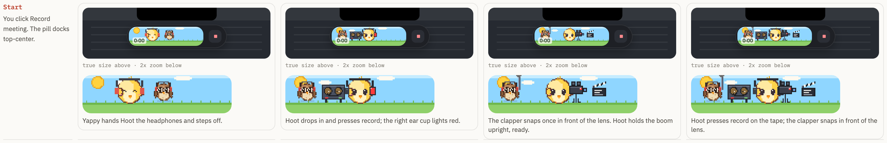
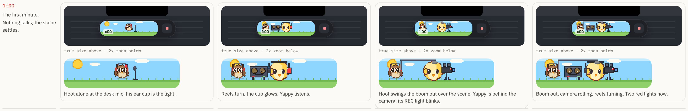
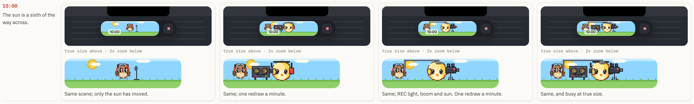
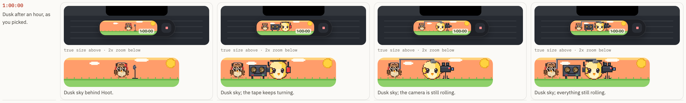
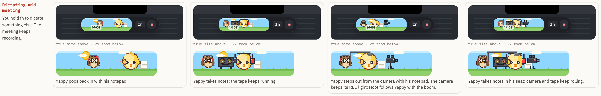
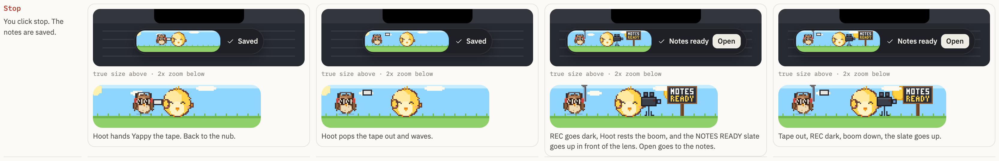

# Pill page, section 16: meetings as a film crew (option C)

Design only, no app code. Item `yap-1106-fb-06-film-crew-design` (FB-06). Wilson, 15:25Z: "like a movie
production, like a cameraman recording with a … boom mic"; 16:35Z: "should we give hoot a boom mic".

This is a new section for the same Pill page artifact
(`~/Obsidian/Wilson-Brain/Projects/Yap/design-2026-11-06/pill.html`). It puts option C next to option A
(Hoot takes the desk) and option B (Hoot runs the tape beside Yappy, approved in section 9), and adds a
fourth column, C on top of B, to show how the two combine.

## What option C is

During a meeting the pill becomes a small production. Yappy works a camera on a tripod; Hoot holds a boom mic
over the scene. The recording light is the red REC light on the camera, so it stays on the gear and never on a
character. A clapperboard snaps in front of the lens at the start, and a "NOTES READY" slate goes up in front
of the lens at the stop. Everything binding from the approved pages still holds: the sun crossing the sky is
the meeting clock (dusk after an hour), the timer lives inside the one pill, and that pill docks top-center.

## Frames

Every cell is the pill at true size on a strip of screen (rendered at device scale 2, a Retina Mac) with a 2x
zoom of the scene underneath. Columns: A, B (approved), C, C on top of B.

| Moment | PNG |
|---|---|
| Start (clapper) |  |
| 1:00 |  |
| 10:00 |  |
| 1:00:00 (dusk) |  |
| Dictating mid-meeting |  |
| Stop ("notes ready" slate) |  |

The whole section in one image: [film-crew-section.png](pill-film-crew-2026-11/png/film-crew-section.png).

| Moment | C, film crew | C on top of B |
|---|---|---|
| Start | The clapper snaps once in front of the lens. Hoot holds the boom upright, ready. | Hoot presses record on the tape; the clapper snaps in front of the lens. |
| 1:00 | Hoot swings the boom out over the scene. Yappy is behind the camera; its REC light blinks. | Boom out, camera rolling, reels turning. Two red lights now (REC and the ear cup). |
| 10:00 | Same; only the sun has moved a sixth of the way. | Same, and busy at true size. |
| 1:00:00 | Dusk sky; the camera is still rolling. | Dusk sky; everything still rolling. |
| Dictating | Yappy steps out from the camera with his notepad; the camera keeps its REC light and Hoot follows him with the boom. The `fn` chip shows in the pill. | Yappy takes notes in his seat; camera and tape keep rolling. |
| Stop | REC goes dark, Hoot rests the boom, the NOTES READY slate goes up. The pill says "Notes ready" with Open, which goes to the meeting notes. | Tape out, REC dark, boom down, the slate goes up, same "Notes ready · Open". |

## Motion, power and reduce motion

The REC light blinks once every 1.6 s and the boom sways 1 px every 4 s. Everything else holds still between
the once-a-minute sun steps, the same power cost as the red-dot version. With reduce motion on, the REC light
stays solid, the clapper is drawn closed in its one frame and the boom never sways.

## How C combines with B, and the call

C on top of B works, but at true size the 140 px window carries five things at once (Hoot, the reels, Yappy in
headphones, the camera and the boom), and the REC light and the red ear cup say "recording" twice. If Wilson
likes both, the calmer mix is B for the hour plus C's two bookends: the clapper at start and the NOTES READY
slate at stop, which only show for a few seconds.

**Wilson picks A, B, C, or C on top of B** before `yap-1106-pill-rec-headphones-hoot-tape` builds its Hoot
half. Until he picks, that item keeps building B, which is already approved.

## Files

- `pill-film-crew-2026-11/page.html` — the section as a page (section 16, "Your pick: A, B or C").
- `pill-film-crew-2026-11/film-crew.js` — the scenes and the film gear: `camera` (REC light), `boomOut` /
  `boomRest`, `clapper`, `slate` ("NOTES READY" in 3 x 5 chalk letters). Drop-in for the Pill page: it needs
  only `#fcRows` and the Yappy, PK, R3 and FR globals the Pill page already loads.
- `pill-film-crew-2026-11/assets/` — the approved art kit, copied verbatim from `design-2026-11-06/assets/`
  (yappy.js, pill-kit.js, friends-hd.js, pill-r3.js, review.css).
- `pill-film-crew-2026-11/render.mjs` — re-renders the PNGs headless through `scripts/headless-chrome.mjs`
  (`node docs/design/pill-film-crew-2026-11/render.mjs`); stops its Chrome by PID and deletes the temp profile.
- `pill-film-crew-2026-11/png/` — the seven PNGs above.

No user-visible surface names an AI vendor or model. Nothing here ships in the app.
